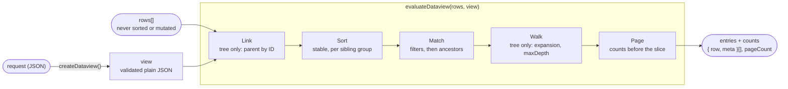
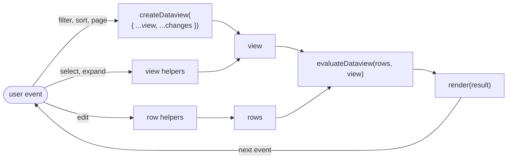

# defuss-dataview

[](LICENSE)
[](https://www.npmjs.com/package/defuss-dataview)
[](package.json)
[](tsconfig.json)
[](package.json)

**Data views** for tables and trees: filter, sort and page with one JSON descriptor, zero dependencies.

Isomorphic functional filters, sorting, pagination, tree traversal and UI metadata for table and tree grids. ESM and CommonJS with TypeScript declarations, plus a standalone browser module for pages and module workers. It is the query engine behind [defuss-shadcn](https://github.com/kyr0/defuss-shadcn)'s Big Data components; [dataview.defuss.org](https://dataview.defuss.org) runs them on up to 1,000,000 generated rows and has a query explorer for your own rows.

## TL;DR

A table or tree grid needs more than the rows on screen: the filtered and sorted page, the counts its pager shows, the selection, the expanded nodes, and the same state again after a reload, in a worker or on a server.

defuss-dataview keeps that state in one plain JSON descriptor. `createDataview()` validates it once, and `evaluateDataview(rows, view)` returns the requested page with its counts, in a browser page, a module worker or Node.js.

- 🧾 **One descriptor:** filters, sorters, paging, tree options and UI metadata as JSON you can store, send to a server or restore after a reload
- 🌳 **Table or tree:** add `tree: { idField, parentIdField }`, and matches keep their ancestors, siblings sort among themselves and expansion is explicit state
- 🔢 **Exact counts:** `totalRows`, `matchedRows`, `visibleRows`, `pageCount` and paging flags, never inferred from a page's length
- 🔒 **Your rows stay yours:** the backing array is never sorted or mutated, entries keep row object identity, and the row helpers return the same array on a no-op
- 🧯 **Hostile data terminates:** parent cycles, 30,000-level hierarchies, duplicate IDs and paths such as `__proto__` have defined results instead of hangs, stack overflows or prototype access
- 🔁 **Isomorphic:** no DOM, Node API, globals, subscriptions or storage access
- 🪶 **Small:** zero runtime dependencies; the standalone browser module is 12.7 kB minified, 4.6 kB gzip
- 🧩 **Compatible with 0.3.1:** every export retained; all 67 original tests, byte-for-byte unchanged, pass

## How it works

`createDataview()` turns a request into a view once; `evaluateDataview(rows, view)` runs the steps below on every call, without caching or hidden state. A flat view skips the two tree-only steps.



| API | When you reach for it | What it does |
|---|---|---|
| **`createDataview(request?)`** | building or changing query state | Validates filters, sorters, paging, tree options and UI metadata and returns a normalized `DataviewState`. A malformed descriptor throws. |
| **`evaluateDataview(rows, view)`** | a grid with a pager and counts | The requested entries plus `totalRows`, `matchedRows`, `visibleRows`, `pageCount` and the paging flags. |
| **`applyDataview(rows, view)`** | the entries without counts | The same entries as `Array<{ row, meta }>`, the 0.3.1 contract. |
| **View helpers** | selection, expansion, locked columns | `updateMeta`, `setSelectedRows`, `toggleSelectedRow`, `setLockedColumns`, `setExpandedIds` and `toggleExpanded` return an updated view, the same view on a no-op; filters, sorters and paging stay as they are. |
| **Row helpers** | editing the data | `updateRows`, `addRows`, `removeRows` and `setParent` return an updated array, the input array on a no-op; unchanged rows keep their identity. |

## Install

```sh
npm install defuss-dataview
# or: bun add defuss-dataview
```

Without a bundler, import the standalone browser module by URL, for example from jsDelivr:

```js
import { createDataview, evaluateDataview } from 'https://cdn.jsdelivr.net/npm/defuss-dataview@0.4.0/dist/browser.min.mjs';
```

## Quick Start

```ts
import { createDataview, applyDataview, evaluateDataview } from 'defuss-dataview';

const data = [
  { id: 1, name: 'Ada', score: 92 },
  { id: 2, name: 'Grace', score: 98 },
  { id: 3, name: 'Linus', score: 75 },
];
const view = createDataview({
  filters: [{ field: 'score', op: 'gte', value: 80 }],
  sorters: [{ field: 'score', direction: 'desc' }],
  page: 0, pageSize: 1,
  meta: { selectedRowIds: [2], lockedColumns: ['name'] },
});

const entries = applyDataview(data, view); // The 0.3.1 [{ row, meta }] contract.
console.log(entries[0].row.name);         // Grace
console.log(entries[0].meta.isSelected);  // true

const result = evaluateDataview(data, view);
console.log(result.matchedRows); // 2
console.log(result.pageCount);   // 2
console.log(result.hasNextPage); // true
```

## API

### `createDataview(request = {})`

Validates a request and returns a normalized `DataviewState`. A malformed descriptor throws a `TypeError` or `RangeError`.

| Field | Type | Default | Description |
|---|---|---|---|
| `filters` | `Array<{ field, op, value }>` | `[]` | ANDed; see [filters and sorting](#filters-and-sorting) |
| `sorters` | `Array<{ field, direction? }>` | `[]` | Applied in order; `direction` is `asc` or `desc` |
| `page` | `number` | `0` | Zero-based page index |
| `pageSize` | `number` | unpaged | Positive safe integer; omit it to disable paging |
| `idField` | `string` | `'id'`, or `tree.idField` in a tree | Field that identifies rows for selection |
| `meta` | `{ selectedRowIds?, lockedColumns? }` | both `[]` | UI metadata |
| `tree` | `DataviewTreeOptions` | flat view | See [trees and expansion](#trees-and-expansion) |

`page` must be a safe nonnegative integer, and the offset `page * pageSize` must stay in the safe integer range; without `pageSize`, `page` has no effect. Out-of-range pages return an empty array rather than clamping state. Use `createDataview({ ...view, page: 0, filters: nextFilters })` when a UI filter changes. Normalization validates structure; filter values remain caller-owned references to preserve equality semantics.

### `evaluateDataview(rows, view)` / `applyDataview(rows, view)`

`applyDataview` returns `Array<{ row, meta }>`. `evaluateDataview` returns the same entries with counts and paging state:

| Field | Meaning |
|---|---|
| `entries` | The requested page; identical to `applyDataview` output |
| `totalRows` | Backing input length |
| `matchedRows` | Rows satisfying filters, before ancestor/descendant inclusion and collapse |
| `visibleRows` | Included rows passing expansion/maxDepth, before paging |
| `page`, `pageSize` | Descriptor values |
| `pageCount` | `ceil(visibleRows / pageSize)`; unpaged: 1 if nonempty, otherwise 0 |
| `hasPreviousPage`, `hasNextPage` | Paging navigation flags; both false when unpaged |

Both functions accept readonly backing arrays and preserve row object identities. They never sort or mutate the backing array. Treat descriptors and row data as immutable while applying a query; no caching or mutation tracking is hidden inside the package.

Flat views have equal `matchedRows` and `visibleRows`. Tree views can have more visible rows than matches (included ancestors), or fewer (collapsed matches). Counts are not inferred from a page's length. If a requested page exceeds the last page, `hasPreviousPage` remains true when any page exists, allowing the application to recover or clamp explicitly.

Every entry has `meta: { depth, hasChildren, isExpanded, isMatch, isSelected, parentId }`. Flat entries have depth 0, no children/expansion, true `isMatch`, and null `parentId`.

### Filters and sorting

Fields use nonempty dot paths and own-property traversal. `__proto__`, `prototype`, `constructor`, empty segments and empty paths are rejected. Fields inherited from a prototype do not participate. Accessors/getters on actual own row properties may execute; rows should be ordinary application data.

Filters are ANDed; available operators are `eq`, `neq`, `gt`, `gte`, `lt`, `lte`, `in`, `contains`, `startsWith`, `endsWith`. Equality and array membership retain strict JavaScript equality, including reference equality for object-valued filter operands. String operations are case-sensitive. An `in` operand that is not an array matches nothing. Null, missing, `NaN`, and invalid-date cells do not match relational operators. JSON-compatible filter operands can be serialized, but object reference equality does not survive a JSON round trip; use scalar field predicates for portable queries.

Sorters accept `direction` or its alias `dir` (`asc` default); `direction` takes precedence. Equal values preserve input order. Mixed values use ascending type order: booleans, numbers, BigInts, strings, valid Dates, other values, invalid numbers/dates, nullish values. Descending reverses that ordering. Numbers and Dates sort numerically; strings use the runtime's `localeCompare`, which can differ between host locales. BigInts and other values retain the legacy lexical `String(value)` comparison. Objects with throwing/string-conversion side effects are outside the plain-data sorting contract. `NaN` values tie stably; `null` and `undefined` also tie stably.

### Trees and expansion

```ts
import { createDataview, applyDataview, toggleExpanded, setExpandedIds } from 'defuss-dataview';

const rows = [
  { id: 1, parentId: null, name: 'Root' },
  { id: 2, parentId: 1, name: 'Child' },
];
let view = createDataview({ tree: { idField: 'id', parentIdField: 'parentId' } });
console.log(applyDataview(rows, view).length); // 2: omitted expansion list opens all.
view = toggleExpanded(view, 1);
console.log(applyDataview(rows, view).length); // 1: toggling closes this root.
view = setExpandedIds(view, []);              // Explicitly collapse all.
```

| Tree option | Behavior |
|---|---|
| `idField`, `parentIdField` | Required dot paths defining graph identity |
| Omitted `expandedIds` | Defaults to `expandAll: true` |
| Explicit `expandedIds: []` | Defaults to `expandAll: false`: collapse all |
| Nonempty `expandedIds` | Expand listed IDs only, unless `expandAll` is explicitly true |
| `expandAll: true` | Expand all except `collapsedIds` |
| `collapsedIds` | Exceptions used only in expand-all mode |
| `maxDepth` | Nonnegative safe integer, root depth 0; capped nodes are not reported expanded |
| `includeAncestors` | Include ancestors of matches; default true |
| `includeDescendantsOfMatch` | Include descendants of matching nodes; default false |

Expansion flags are explicit JSON state; default-mode toggles update `collapsedIds`, so they work without access to backing rows. `setExpandedIds` switches to explicit-list mode and clears exceptions. Expand/collapse helpers are no-ops on flat views. To expand all again, use `createDataview({ ...view, tree: { ...view.tree!, expandAll: true, collapsedIds: [] } })`.

Traversal is sorted preorder: sort roots and each sibling group separately. Filters do not promote descendants to root level; depths retain hierarchy position, and a collapsed excluded ancestor still hides its descendants. Paging applies to the visible flattened sequence, so a page may begin at a child. `hasChildren` describes the source hierarchy, even when children do not match the filter.

Missing/null IDs are unindexed; missing/null or unknown parents become roots. Duplicate IDs keep separate rows, with parent references resolving to the first occurrence. Self-parent rows render as roots. For longer cycles, traversal cuts one rendering edge per cycle at its lowest original input index. This also retains cyclic components beside ordinary roots. Input rows are unchanged and `meta.parentId` retains the original parent value, including the cut edge. IDs should still be unique for meaningful selection and moves. An explicit top-level `idField` controls selection even in a tree; otherwise it inherits `tree.idField`.

### View and row helpers

| Function | Return / behavior |
|---|---|
| `updateMeta(view, updates)` | Update UI metadata without rebuilding query state |
| `setSelectedRows(view, ids)` / `toggleSelectedRow(view, id)` | Replace/toggle selection |
| `setLockedColumns(view, columns)` | Deduplicated nonempty column names |
| `setExpandedIds(view, ids)` / `toggleExpanded(view, id)` | Explicit expansion list / toggle effective expansion |
| `updateRows(rows, ids, updates, idField = 'id')` | Batch shallow patches; unchanged rows retain identity |
| `addRows(rows, newRows, anchorId?, position = 'after', idField = 'id')` | Insert before/after the first anchor; missing anchor appends |
| `removeRows(rows, ids, idField = 'id')` | Remove matching rows, without implicit subtree deletion |
| `setParent(rows, nodeId, parentId, idField = 'id', parentIdField = 'parentId')` | Immutable move; reject self/descendant/cyclic parent chains |

Row helpers retain the input array on a no-op. Matching update IDs repeated in one batch use the last patch, preserving the old behavior. Matching duplicate row IDs are all updated/removed. `updateRows` is a shallow merge: patch keys are literal property names, not dot-path assignments. IDs and `setParent` field arguments do support dot paths. Array-index segments use dot syntax such as `links.0.parent`; bracket syntax is not a path syntax here.

`setParent` changes the named parent path, copying only its ancestors. Moving to a missing parent is allowed (an orphan renders as a root); use `null` to detach. It does not mutate descendants. Generic `updateRows` and `addRows` do not enforce graph integrity, so external or patched graphs can still contain cycles; traversal handles those deterministically.

### Identity and controlled state

Selection, expansion, parent linking and row helpers share canonical JSON ID matching. Objects compare by JSON contents independent of property-key order; arrays preserve order; numeric and string IDs remain distinct. Finite numbers, booleans, strings, plain objects and dense arrays are supported. `-0` and `0` share their JSON identity. `null`/missing row IDs are not selectable or indexed as tree parents; row helpers can explicitly match a null ID. Missing IDs never alias null.

Non-finite numbers, `undefined` as an explicit ID, BigInts, dates, functions, symbols, cycles, accessors, hidden properties and sparse/extended arrays are rejected as identifiers. Ordinary non-ID row fields may still contain Dates, BigInts, etc. Normalization copies selection and expansion IDs, so caller mutation does not change normalized state. Meta updates preserve extensions on the view, retain untouched query references, and return the same view for a semantic no-op. Extension fields on `view.meta` are also retained.

There are no globals, subscriptions, storage access, DOM dependencies or automatic persistence. A store such as [defuss-store](https://www.npmjs.com/package/defuss-store) can own the descriptor, but is not required. The [controlled grid](#controlled-grid) pattern shows how data and view stay apart.

### Types

```ts
// Abridged from src/types.ts.
type DataviewFilterOperator = 'eq' | 'neq' | 'gt' | 'gte' | 'lt' | 'lte' | 'in' | 'contains' | 'startsWith' | 'endsWith';

interface DataviewEntry<T> { row: T; meta: DataviewRowMeta }
interface DataviewRowMeta { depth: number; hasChildren: boolean; isExpanded: boolean; isMatch: boolean; isSelected: boolean; parentId: DataviewJsonValue | null }
interface DataviewResult<T> { entries: DataviewEntry<T>[]; totalRows: number; matchedRows: number; visibleRows: number; page: number; pageSize?: number; pageCount: number; hasPreviousPage: boolean; hasNextPage: boolean }
```

The declarations ship as `dist/index.d.mts` and `dist/index.d.cts`; [src/types.ts](src/types.ts) is their source of truth.

## Speed

Medians of one `evaluateDataview()` call on `dist/index.mjs`, measured for 0.4.0 (commit `a53e07e`) on an Apple M4 (10 cores) with Node.js v24.14.0 on macOS. Each median takes 15 timed calls (9 at 100,000 rows, 5 at 1,000,000) after 3 untimed ones; rows are generated before timing and pages hold 50 rows. `make site-metrics` measures again and writes [docs/assets/metrics.json](docs/assets/metrics.json), which the website charts.

### Lists and trees by row count

Lists hold `{ id, name, score }` rows; the filter keeps half of them, and the sort orders by `score` descending, then `name`. Trees are balanced with four children per node; their filter keeps `score >= 90` and sorts siblings by `score` descending.

| Rows | List: filter + page | List: filter + sort + page | Tree: all open + page | Tree: filter + sort siblings + page |
|---:|---:|---:|---:|---:|
| 1,000 | 0.06 ms | 0.18 ms | 0.28 ms | 0.33 ms |
| 10,000 | 0.23 ms | 2.2 ms | 2.1 ms | 2.5 ms |
| 100,000 | 2.5 ms | 24 ms | 19 ms | 28 ms |
| 1,000,000 | 32 ms | 318 ms | 236 ms | 346 ms |

### Trees by depth

A chain where every row is the child of the one before, so a depth of 100,000 means 100,001 rows.

| Depth | All open + page | Match the deepest row + its ancestors |
|---:|---:|---:|
| 10 | 0.01 ms | 0.01 ms |
| 100 | 0.06 ms | 0.06 ms |
| 1,000 | 0.22 ms | 0.22 ms |
| 10,000 | 2.2 ms | 2.0 ms |
| 100,000 | 24 ms | 24 ms |

From 10,000 rows up, ten times the rows took 9 to 13 times as long in every scenario. A chain 100,000 levels deep took 24 ms and a balanced tree of 100,000 nodes 19 ms. Traversal does not recurse, so depth meets no stack limit.

These are absolute times on one machine, not a comparison. Against upstream 0.3.1, `npm run benchmark:compare` records nine alternating local samples after three warmups, first checking output equivalence. Robustness and consistent identity add work, and no universal speedup is claimed. `npm run benchmark` retains the original 10k/50k/1M benchmark scenarios. Benchmarks are non-gating; reports are in `artifacts/`, and build sizes are measured in `dist/stats.json`.

## When to use it

On the measured machine, one call over 100,000 rows took 2.5 to 28 ms, and filter + sort + page over 1,000,000 rows took 318 ms. The guidance below builds on those numbers and on the contract above.

### DO: use it for

- **Grids, lists and trees whose rows are in memory:** in a page, a module worker or a server handler, with the same descriptor
- **Query state you persist or send:** the descriptor is plain JSON for a URL, `localStorage` or a request body
- **Hierarchies you do not control:** cycles, duplicate IDs, unknown parents and very deep chains have defined results
- **Grid controls that need exact counts:** pagers and "x of y matches" labels

### DON'T: use it for

- **Data that stays in a database:** it filters arrays in memory and does not translate a descriptor into SQL or a backend query
- **Incremental updates:** every call evaluates the whole array again; nothing is cached or tracked between calls
- **OR conditions, case-insensitive or fuzzy search:** filters are ANDed and string operators are case-sensitive; for case-insensitive search, store a lowercased copy of the field and filter on that
- **A main-thread sort of a million rows on every keystroke:** on the measured machine, that took 318 ms of main-thread time; move the query into a [module worker](#query-in-a-module-worker)

### Key principles

1. **Reset the page when the query changes.** An out-of-range page returns an empty array instead of clamping.
2. **Keep IDs unique JSON values.** Selection, expansion and moves match IDs by canonical JSON; duplicate IDs keep separate rows, but parents resolve to the first occurrence.
3. **Edit rows through the row helpers.** They return a new array but keep unchanged row objects, so your renderer can compare rows by identity.
4. **Use scalar filter values for portable queries.** Object operands compare by reference, which a JSON round trip does not keep.
5. **Expect host-dependent string order.** Strings sort with the runtime's `localeCompare`.

## Patterns

### Controlled grid

Keep data and view apart: patch data with the row helpers, change query state with `createDataview`, change selection and expansion with the view helpers, then evaluate again.



```ts
import { createDataview, evaluateDataview, toggleSelectedRow, updateRows } from 'defuss-dataview';

let rows = [
  { id: 1, name: 'Ada', score: 92 },
  { id: 2, name: 'Grace', score: 98 },
  { id: 3, name: 'Linus', score: 75 },
];
let view = createDataview({ sorters: [{ field: 'score', direction: 'desc' }], pageSize: 2 });

view = createDataview({ ...view, page: 0, filters: [{ field: 'score', op: 'gte', value: 80 }] }); // filter input
view = toggleSelectedRow(view, 2);                // row click
rows = updateRows(rows, [3], [{ score: 85 }]);    // cell edit

const result = evaluateDataview(rows, view);      // hand this to your table component
console.log(result.entries.map((entry) => entry.row.name)); // ['Grace', 'Ada']
console.log(result.matchedRows, result.pageCount);          // 3 2
```

### Query in a module worker

`worker.js` keeps the rows and answers requests:

```js
import { createDataview, evaluateDataview } from 'https://cdn.jsdelivr.net/npm/defuss-dataview@0.4.0/dist/browser.min.mjs';

let rows = [];
self.onmessage = ({ data }) => {
  if (data.rows) rows = data.rows;
  if (data.request) self.postMessage(evaluateDataview(rows, createDataview(data.request)));
};
```

The page sends the rows once and a request per change:

```js
const worker = new Worker(new URL('./worker.js', import.meta.url), { type: 'module' });
worker.onmessage = ({ data }) => console.log(data.matchedRows, data.entries);
worker.postMessage({ rows });
worker.postMessage({ request: { filters: [{ field: 'score', op: 'gte', value: 80 }], page: 0, pageSize: 50 } });
```

If a bundler builds your worker, import `'defuss-dataview'` there instead of the URL. The result crosses the worker boundary as a structured clone, so its entries hold copies of the rows, not the page's objects; match them by ID.

### Persist and restore the descriptor

```ts
localStorage.setItem('grid-view', JSON.stringify(view));
const restored = createDataview(JSON.parse(localStorage.getItem('grid-view') ?? '{}'));
```

Selection, expansion, filters, sorters and paging survive the round trip; object-valued filter operands lose their reference equality.

## Migration from 0.3.1

All 67 original tests remain byte-for-byte unchanged and pass. Deliberate corrections requiring attention:

- **Explicit `expandedIds: []` now collapses all.** Omit it, or set `expandAll: true`, to open all. Old saved descriptors normalized by 0.3.1 cannot distinguish omitted from explicit empty lists; migrate those intentionally.
- Cycles terminate and no longer disappear beside other roots; deep/wide trees no longer depend on recursion or spread argument limits.
- Object/array IDs now use structural JSON identity consistently; unsupported/lossy IDs fail instead of colliding. Row IDs that are not JSON values (e.g. BigInt) are reported unselected rather than failing selection lookup.
- Inherited properties and unsafe/malformed paths no longer match. Data-patch field arguments now honor the same dot paths as queries.
- No-op patches/meta updates preserve references. View extension fields are retained.
- Mixed-type ordering is explicit and transitive for ordinary scalar data; NaN/invalid dates tie stably. Invalid/nullish relational cells no longer match.
- `setParent` rejects moves into self, descendants, or an existing cyclic parent chain. It still allows unknown parents and does not validate unrelated components.
- Paging/depth validation rejects unsafe integers. A node stopped by `maxDepth` is not reported expanded.

The legacy filter operators, strict filter equality, `dir` alias, null sort direction, lexical BigInt fallback, duplicate-parent first-wins policy, row-reference preservation, patch signatures and all public exports remain available. `evaluateDataview` is additive.

## What "verified" means

`npm run check` runs the suites below, and `prepublishOnly` runs it before every `npm publish`.

```sh
npm ci
npx playwright install --with-deps chromium
npm run check
```

- `npm run lint` and `npm run typecheck`: oxlint with warnings denied; source and public API types, including the type tests in `tests/types/`
- `npm run test:coverage`: unit, regression and differential tests on Node.js with V8 coverage, including the 67 original tests, hash-pinned in `tests/fixtures/provenance.json`
- `npm run test:browser`: Playwright in real Chromium: the built browser module filtering, sorting and paging; selection and descriptor surviving JSON storage and a reload; tree expansion in the example UI; a 30,000-level hierarchy in a module worker without DOM or Node globals; and the website
- `npm run test:package`: installs the packed tarball in an isolated consumer and checks ESM and CommonJS runtime imports, both declaration modes, Bundler resolution, SSR without DOM globals, and browser bundling without workspace aliases
- `npm run verify`: release integrity: exports, package metadata and the upstream fixture and test hashes

`make verify` runs lint, test, coverage and e2e (build, Chromium, tarball consumer), as the `verify` CI workflow does. Outside `check`, `npm run audit:upstream` reproduces ten defects against the pinned original source, with a separate process deadline for the infinite loop. The website shows test counts and coverage from the last `make site-metrics` run, stored in `docs/assets/metrics.json`.

`npm run dev` serves the interactive example and the website after a build:

```sh
npm run dev
# http://127.0.0.1:4179        the example
# http://127.0.0.1:4179/docs/  the website, which loads the newest published release from jsDelivr
```

The example implements sorting, search, paging, selection, tree expansion and JSON descriptor restoration. `docs/` is the website's source; `docs/CNAME` names its GitHub Pages domain.

### Deliberate limits

No caching or mutation tracking between calls, no automatic persistence, no OR groups in filters and no clamping of out-of-range pages. `updateRows` and `addRows` do not enforce graph integrity, `removeRows` leaves descendants in the array, and `setParent` allows unknown parents; traversal handles the resulting cycles deterministically. [ARCH.md](ARCH.md) holds the implementation details, [RELEASE.md](RELEASE.md) the release instructions and [CHANGELOG.md](CHANGELOG.md) the history.

## Requirements

- **Node.js** ^18.17.1 || ^20.3.0 || >=21.0.0 at runtime, unchanged from 0.3.1; Node 22 or 24 for development and release tooling
- **Bun** installs and runs the package
- **Bundlers** resolve `import ... from 'defuss-dataview'`; CommonJS uses `require('defuss-dataview')`
- **Browsers and module workers** import `dist/browser.mjs` or `dist/browser.min.mjs` (ES2022) by URL; they are physical assets with source maps, not package-export subpaths. Public types need only ES2022 libraries, with no DOM or Node ambient types.

## Citation

If you use defuss-dataview in research or want to reference it, cite it as:

```bibtex
@misc{homberg2026defussdataview,
  author       = {Homberg, Aron},
  affiliation  = {Independent Researcher},
  title        = {defuss-dataview: Isomorphic Filtering, Sorting, Paging and Tree Traversal for Table and Tree Grids},
  year         = {2026},
  version      = {0.4.0},
  howpublished = {\url{https://www.npmjs.com/package/defuss-dataview}},
  note         = {npm package, MIT License}
}
```

## License

MIT, see [LICENSE](LICENSE). Based on [kyr0/defuss `packages/dataview`](https://github.com/kyr0/defuss/tree/main/packages/dataview) 0.3.1; [NOTICE](NOTICE) records the pinned upstream commit and provenance.
