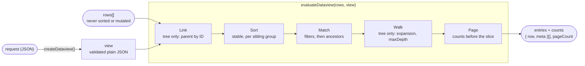
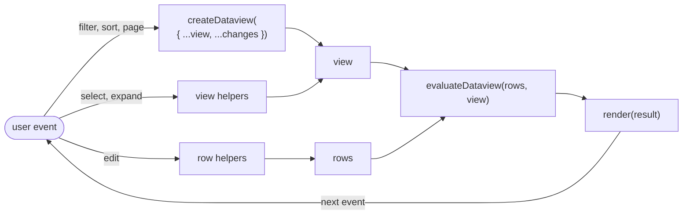

# defuss-dataview

[](LICENSE)
[](https://www.npmjs.com/package/defuss-dataview)
[](package.json)
[](tsconfig.json)
[](package.json)

**Data views** for tables and trees, and bounded queries over snapshot record streams: filter, sort and page with one descriptor, zero dependencies.

Isomorphic functional filters, sorting, pagination, tree traversal and UI metadata for table and tree grids, plus a streaming executor with explicit memory and work limits for sources that do not fit one array. ESM and CommonJS with TypeScript declarations, plus standalone browser modules for pages and module workers. It is the query engine behind [defuss-shadcn](https://github.com/kyr0/defuss-shadcn)'s Big Data components; [dataview.defuss.org](https://dataview.defuss.org) runs them on up to 1,000,000 generated rows and has a query explorer for your own rows.

## TL;DR

A table or tree grid needs more than the rows on screen: the filtered and sorted page, the counts its pager shows, the selection, the expanded nodes, and the same state again after a reload, in a worker or on a server.

defuss-dataview keeps that state in one plain JSON descriptor. `createDataview()` validates it once, and `evaluateDataview(rows, view)` returns the requested page with its counts, in a browser page, a module worker or Node.js.

- **One descriptor:** filters, sorters, paging, tree options and UI metadata as JSON you can store, send to a server or restore after a reload
- **Table or tree:** add `tree: { idField, parentIdField }`, and matches keep their ancestors, siblings sort among themselves and expansion is explicit state
- **Exact counts:** `totalRows`, `matchedRows`, `visibleRows`, `pageCount` and paging flags, never inferred from a page's length
- **Your rows stay yours:** the backing array is never sorted or mutated, entries keep row object identity, and the row helpers return the same array on a no-op
- **Hostile data terminates:** parent cycles, 30,000-level hierarchies, duplicate IDs and paths such as `__proto__` have defined results instead of hangs, stack overflows or prototype access
- **Isomorphic:** no DOM, Node API, globals, subscriptions or storage access
- **Snapshot streams:** `defuss-dataview/stream` pages, sorts and counts over batched sources such as DBSONL with stable top-k, cancellation and row, byte and work budgets that fail instead of truncating
- **Projection and aggregation:** `defuss-dataview/compute` selects computed columns, groups with exact typed equality, and returns a page plus totals from one scan of the same sources
- **Small:** zero runtime dependencies; the standalone table/tree browser module is 17.0 kB minified, 6.1 kB gzip
- **Close to 0.3.1:** every export retained; 65 of the 67 original tests pass byte-for-byte unchanged, and the other two encode [deliberate 0.5.0 changes](#behavior-changes-in-050)

## How it works

`createDataview()` turns a request into a view once; `evaluateDataview(rows, view)` runs the steps below on every call, without caching or hidden state. A flat view skips the two tree-only steps.



| API | When you reach for it | What it does |
|---|---|---|
| **`createDataview(request?)`** | building or changing query state | Validates filters, sorters, paging, tree options and UI metadata and returns a normalized `DataviewState`. A malformed descriptor throws. |
| **`evaluateDataview(rows, view)`** | a grid with a pager and counts | The requested entries plus `totalRows`, `matchedRows`, `visibleRows`, `pageCount` and the paging flags. |
| **`applyDataview(rows, view)`** | the entries without counts | The same entries as `Array<{ row, meta }>`, the 0.3.1 contract. |
| **View helpers** | selection, expansion, locked columns | `updateMeta`, `setSelectedRows`, `toggleSelectedRow`, `setLockedColumns`, `setExpandedIds` and `toggleExpanded` return an updated view, the same view on a no-op; filters, sorters and paging stay as they are. |
| **Row helpers** | editing the data | `updateRows`, `addRows`, `removeRows` and `setParent` return an updated array, the input array on a no-op; unchanged rows keep their identity. |

The package has four entry points. The table/tree API and the stream executor share one query compiler, so a filter or sort means the same thing in a grid and in a stream.

| Entry point | Purpose |
|---|---|
| `defuss-dataview` | Table/tree evaluation, pagination, selection and immutable row updates |
| `defuss-dataview/query` | Compile shared predicates and comparators |
| `defuss-dataview/stream` | Snapshot sources, bounded streaming, stable top-k, prepared queries, indexes, cancellation |
| `defuss-dataview/adapters/dbsonl` | Structural DBSONL adapter with optional native batches |

## Install

```sh
npm install defuss-dataview
# or: bun add defuss-dataview
```

Without a bundler, import the standalone browser module by URL, for example from jsDelivr:

```js
import { createDataview, evaluateDataview } from 'https://cdn.jsdelivr.net/npm/defuss-dataview@0.6.0/dist/browser.min.mjs';
```

`dist/browser-stream.mjs`, `dist/browser-query.mjs` and `dist/browser-dbsonl.mjs` are the matching standalone modules for the other entry points.

## Quick Start

```ts
import { createDataview, applyDataview, evaluateDataview } from 'defuss-dataview';

const data = [
  { id: 1, name: 'Ada', score: 92 },
  { id: 2, name: 'Grace', score: 98 },
  { id: 3, name: 'Linus', score: 75 },
];
const view = createDataview({
  filters: [{ field: 'score', op: 'gte', value: 80 }],
  sorters: [{ field: 'score', direction: 'desc' }],
  page: 0, pageSize: 1,
  meta: { selectedRowIds: [2], lockedColumns: ['name'] },
});

const entries = applyDataview(data, view); // The 0.3.1 [{ row, meta }] contract.
console.log(entries[0].row.name);         // Grace
console.log(entries[0].meta.isSelected);  // true

const result = evaluateDataview(data, view);
console.log(result.matchedRows); // 2
console.log(result.pageCount);   // 2
console.log(result.hasNextPage); // true
```

## API

### `createDataview(request = {})`

Validates a request and returns a normalized `DataviewState`. A malformed descriptor throws a `TypeError` or `RangeError`.

| Field | Type | Default | Description |
|---|---|---|---|
| `filters` | `Array<{ field, op, value }>` | `[]` | ANDed; see [filters and sorting](#filters-and-sorting) |
| `sorters` | `Array<{ field, direction? }>` | `[]` | Applied in order; `direction` is `asc` or `desc` |
| `page` | `number` | `0` | Zero-based page index |
| `pageSize` | `number` | unpaged | Positive safe integer; omit it to disable paging |
| `idField` | `string` | `'id'`, or `tree.idField` in a tree | Field that identifies rows for selection |
| `meta` | `{ selectedRowIds?, lockedColumns? }` | both `[]` | UI metadata |
| `tree` | `DataviewTreeOptions` | flat view | See [trees and expansion](#trees-and-expansion) |

`page` must be a safe nonnegative integer, and the offset `page * pageSize` must stay in the safe integer range; without `pageSize`, `page` has no effect. Out-of-range pages return an empty array rather than clamping state. Use `createDataview({ ...view, page: 0, filters: nextFilters })` when a UI filter changes. Normalization validates structure; filter values remain caller-owned references to preserve equality semantics.

### `evaluateDataview(rows, view)` / `applyDataview(rows, view)`

`applyDataview` returns `Array<{ row, meta }>`. `evaluateDataview` returns the same entries with counts and paging state:

| Field | Meaning |
|---|---|
| `entries` | The requested page; identical to `applyDataview` output |
| `totalRows` | Backing input length |
| `matchedRows` | Rows satisfying filters, before ancestor/descendant inclusion and collapse |
| `visibleRows` | Included rows passing expansion/maxDepth, before paging |
| `page`, `pageSize` | Descriptor values |
| `pageCount` | `ceil(visibleRows / pageSize)`; unpaged: 1 if nonempty, otherwise 0 |
| `hasPreviousPage`, `hasNextPage` | Paging navigation flags; both false when unpaged |

Both functions accept readonly backing arrays and preserve row object identities. They never sort or mutate the backing array. Treat descriptors and row data as immutable while applying a query; no caching or mutation tracking is hidden inside the package.

Flat views have equal `matchedRows` and `visibleRows`. Tree views can have more visible rows than matches (included ancestors), or fewer (collapsed matches). Counts are not inferred from a page's length. If a requested page exceeds the last page, `hasPreviousPage` remains true when any page exists, allowing the application to recover or clamp explicitly.

Every entry has `meta: { depth, hasChildren, isExpanded, isMatch, isSelected, parentId }`. Flat entries have depth 0, no children/expansion, true `isMatch`, and null `parentId`.

### Filters and sorting

Fields use nonempty dot paths and own-property traversal. `__proto__`, `prototype`, `constructor`, empty segments and empty paths are rejected. Fields inherited from a prototype do not participate. Accessors/getters on actual own row properties may execute; rows should be ordinary application data.

Filters are ANDed; available operators are `eq`, `neq`, `gt`, `gte`, `lt`, `lte`, `in`, `contains`, `startsWith`, `endsWith`. An unknown operator throws a `TypeError`. String operations are case-sensitive. An `in` operand that is not an array matches nothing. Null, missing, `NaN`, and invalid-date cells do not match relational operators.

The table/tree API, the stream executor and `compileQuery` share one compiler:

- **Equality:** SameValueZero for primitives (`NaN` equals `NaN`, also in `in` lists), Date timestamps, and visible bytes for binary values; other objects compare by reference. `null` differs from `undefined`.
- **Ordering:** numbers, BigInts and Dates sort numerically; strings by UTF-16 code units, the same order as DBSONL keys and independent of the host locale; binary values lexicographically by unsigned bytes. Opaque objects, functions and symbols tie stably without string conversion.
- **Mixed types**, ascending: booleans, numbers, BigInts, strings, Dates, binary values, opaque values, invalid numbers/dates, nullish values. Descending reverses that rank. Equal values preserve input order.
- **Options:** `semantics: { equality: 'identity' }` turns off Date/binary value equality. `semantics: { strings: 'locale', locale: 'de', collatorOptions: { numeric: true } }` sorts strings with an explicit `Intl.Collator`; it changes neither equality nor the text filters.

Sorters accept `direction` or its alias `dir` (`asc` default); `direction` takes precedence. Compiled predicates capture the filter and sort configuration and copy Date/binary operands and membership lists; opaque objects keep their identity. JSON-compatible filter operands can be serialized, but JSON cannot carry Date, BigInt or binary operands, and object reference equality does not survive a round trip; use a codec such as DSON for typed descriptors, or scalar field predicates for portable ones.

### Trees and expansion

```ts
import { createDataview, applyDataview, toggleExpanded, setExpandedIds } from 'defuss-dataview';

const rows = [
  { id: 1, parentId: null, name: 'Root' },
  { id: 2, parentId: 1, name: 'Child' },
];
let view = createDataview({ tree: { idField: 'id', parentIdField: 'parentId' } });
console.log(applyDataview(rows, view).length); // 2: omitted expansion list opens all.
view = toggleExpanded(view, 1);
console.log(applyDataview(rows, view).length); // 1: toggling closes this root.
view = setExpandedIds(view, []);              // Explicitly collapse all.
```

| Tree option | Behavior |
|---|---|
| `idField`, `parentIdField` | Required dot paths defining graph identity |
| Omitted `expandedIds` | Defaults to `expandAll: true` |
| Explicit `expandedIds: []` | Defaults to `expandAll: false`: collapse all |
| Nonempty `expandedIds` | Expand listed IDs only, unless `expandAll` is explicitly true |
| `expandAll: true` | Expand all except `collapsedIds` |
| `collapsedIds` | Exceptions used only in expand-all mode |
| `maxDepth` | Nonnegative safe integer, root depth 0; capped nodes are not reported expanded |
| `includeAncestors` | Include ancestors of matches; default true |
| `includeDescendantsOfMatch` | Include descendants of matching nodes; default false |

Expansion flags are explicit JSON state; default-mode toggles update `collapsedIds`, so they work without access to backing rows. `setExpandedIds` switches to explicit-list mode and clears exceptions. Expand/collapse helpers are no-ops on flat views. To expand all again, use `createDataview({ ...view, tree: { ...view.tree!, expandAll: true, collapsedIds: [] } })`.

Traversal is sorted preorder: sort roots and each sibling group separately. Filters do not promote descendants to root level; depths retain hierarchy position, and a collapsed excluded ancestor still hides its descendants. Paging applies to the visible flattened sequence, so a page may begin at a child. `hasChildren` describes the source hierarchy, even when children do not match the filter.

Missing/null IDs are unindexed; missing/null or unknown parents become roots. Duplicate IDs keep separate rows, with parent references resolving to the first occurrence. Self-parent rows render as roots. For longer cycles, traversal cuts one rendering edge per cycle at its lowest original input index. This also retains cyclic components beside ordinary roots. Input rows are unchanged and `meta.parentId` retains the original parent value, including the cut edge. IDs should still be unique for meaningful selection and moves. An explicit top-level `idField` controls selection even in a tree; otherwise it inherits `tree.idField`.

### View and row helpers

| Function | Return / behavior |
|---|---|
| `updateMeta(view, updates)` | Update UI metadata without rebuilding query state |
| `setSelectedRows(view, ids)` / `toggleSelectedRow(view, id)` | Replace/toggle selection |
| `setLockedColumns(view, columns)` | Deduplicated nonempty column names |
| `setExpandedIds(view, ids)` / `toggleExpanded(view, id)` | Explicit expansion list / toggle effective expansion |
| `updateRows(rows, ids, updates, idField = 'id')` | Batch shallow patches; unchanged rows retain identity |
| `addRows(rows, newRows, anchorId?, position = 'after', idField = 'id')` | Insert before/after the first anchor; missing anchor appends |
| `removeRows(rows, ids, idField = 'id')` | Remove matching rows, without implicit subtree deletion |
| `setParent(rows, nodeId, parentId, idField = 'id', parentIdField = 'parentId')` | Immutable move; reject self/descendant/cyclic parent chains |

Row helpers retain the input array on a no-op. Matching update IDs repeated in one batch use the last patch, preserving the old behavior. Matching duplicate row IDs are all updated/removed. `updateRows` is a shallow merge: patch keys are literal property names, not dot-path assignments. IDs and `setParent` field arguments do support dot paths. Array-index segments use dot syntax such as `links.0.parent`; bracket syntax is not a path syntax here.

`setParent` changes the named parent path, copying only its ancestors. Moving to a missing parent is allowed (an orphan renders as a root); use `null` to detach. It does not mutate descendants. Generic `updateRows` and `addRows` do not enforce graph integrity, so external or patched graphs can still contain cycles; traversal handles those deterministically.

### Identity and controlled state

Selection, expansion, parent linking and row helpers share canonical JSON ID matching. Objects compare by JSON contents independent of property-key order; arrays preserve order; numeric and string IDs remain distinct. Finite numbers, booleans, strings, plain objects and dense arrays are supported. `-0` and `0` share their JSON identity. `null`/missing row IDs are not selectable or indexed as tree parents; row helpers can explicitly match a null ID. Missing IDs never alias null.

Non-finite numbers, `undefined` as an explicit ID, BigInts, dates, functions, symbols, cycles, accessors, hidden properties and sparse/extended arrays are rejected as identifiers. Ordinary non-ID row fields may still contain Dates, BigInts, etc. Normalization copies selection and expansion IDs, so caller mutation does not change normalized state. Meta updates preserve extensions on the view, retain untouched query references, and return the same view for a semantic no-op. Extension fields on `view.meta` are also retained.

There are no globals, subscriptions, storage access, DOM dependencies or automatic persistence. A store such as [defuss-store](https://www.npmjs.com/package/defuss-store) can own the descriptor, but is not required. The [controlled grid](#controlled-grid) pattern shows how data and view stay apart.

### Types

```ts
// Abridged from src/types.ts.
type DataviewFilterOperator = 'eq' | 'neq' | 'gt' | 'gte' | 'lt' | 'lte' | 'in' | 'contains' | 'startsWith' | 'endsWith';

interface DataviewEntry<T> { row: T; meta: DataviewRowMeta }
interface DataviewRowMeta { depth: number; hasChildren: boolean; isExpanded: boolean; isMatch: boolean; isSelected: boolean; parentId: DataviewJsonValue | null }
interface DataviewResult<T> { entries: DataviewEntry<T>[]; totalRows: number; matchedRows: number; visibleRows: number; page: number; pageSize?: number; pageCount: number; hasPreviousPage: boolean; hasNextPage: boolean }
```

Every entry point ships ESM and CommonJS declarations, such as `dist/index.d.mts` and `dist/stream.d.cts`; [src/types.ts](src/types.ts) and [src/stream/types.ts](src/stream/types.ts) are their source of truth. [documentation/TABLES.md](documentation/TABLES.md) is the compact table/tree reference.

## Snapshot queries

`defuss-dataview/stream` runs the same filters and sorters over a snapshot source: an array, an immutable revisioned array, an explicit index, DBSONL or your own batched source. One query owns one snapshot from its first pull until completion, error, cancellation or an early `break`.

### Evaluate or stream

```ts
import { createArraySource, evaluateStream } from 'defuss-dataview/stream';

const source = createArraySource([
  { id: 1, amount: 100n },
  { id: 2, amount: 2n },
]);
const { rows, summary } = await evaluateStream(source, {
  sorters: [{ field: 'amount', direction: 'asc' }],
  offset: 0,
  limit: 10,
}, { count: 'exact', batchSize: 128 });
// rows.map(row => row.id) => [2, 1]
// summary.totalMatches => 2; strategy => 'top-k'
```

`createArraySource` snapshots array membership and values on each open using `structuredClone`. `isolation: 'immutable'` copies membership only and requires the caller to keep row values immutable throughout the session. The clone/source allocation is separate from executor budgets. Objects that cannot be structured-cloned require an explicit immutable source or another record source.

### Immutable sources, prepared queries and indexes

For repeated queries over immutable data, use a versioned membership snapshot:

```ts
import { createImmutableArraySource } from 'defuss-dataview/stream';

const cached = createImmutableArraySource([{ id: 1, score: 80 }]);
const revision = cached.replace([{ id: 2, score: 90 }]); // 1n
// New opens see revision 1n; already-open sessions retain their previous rows.
```

Creation and `replace()` copy membership in O(n); `open()` pins it in O(1).
All row objects and their reachable values, including returned rows, must stay
immutable. This is an explicit alternative to per-query cloning, not a change to
`createArraySource` isolation. `count` and bigint `revision` describe the latest
published membership. Old snapshots remain available until their readers finish.

For repeated queries, compile once and optionally prepare accounting:

```ts
import { prepareStreamQuery, createIndexedArraySource } from 'defuss-dataview/stream';
await cached.prepare(); // optional; normal queries fill the bounded cache lazily
const plan = prepareStreamQuery({ sorters: [{ field: 'score', direction: 'desc' }] });
const page = await plan.evaluate(cached, { limit: 50 });
const index = createIndexedArraySource(page.rows, { sorters: [{ field: 'score' }] });
const first = await index.readPage({ limit: 10 });
if (first.nextCursor) await index.readPage({ after: first.nextCursor, limit: 10 });
```

An explicit index materializes its immutable filter/order scope once; cursor pages
avoid scanning its earlier rows. `replace()` rebuilds atomically and invalidates
old cursors. Caches and indexes have separate source-level budgets; see
[streaming API](documentation/STREAMING.md) for lifetime, scope and cost contracts.

### Incremental output


```ts
import { streamQuery } from 'defuss-dataview/stream';

for await (const event of streamQuery(source, {}, { batchSize: 128 })) {
  if (event.type === 'batch') {
    for (const row of event.rows) console.log(row.id);
  } else {
    console.log(event.summary);
  }
}
```

Every batch is provisional until the `complete` event. That event follows successful iterator and snapshot cleanup. An early `break`, cancellation or error closes owned resources; it does not emit a success summary. There is no background prefetch. A paused consumer retains its open snapshot; explicitly return the iterator if abandoning it.

`evaluateStream()` collects rows under a separate retention budget. `streamQuery()` can emit arbitrarily many rows in bounded batches. `toStreamRequest(view)` converts a flat table state into `{filters, sorters, semantics, offset, limit}`.

### DBSONL

```ts
import { openDbsonl, createMemoryBackend } from 'defuss-dbsonl';
import { createDbsonlSource } from 'defuss-dataview/adapters/dbsonl';
import { evaluateStream } from 'defuss-dataview/stream';

const db = await openDbsonl<{ title: string; score: number }>(
  createMemoryBackend(), 'documents', { create: true },
);
try {
  await db.put('doc:1', { title: 'Storage', score: 95 });
  const result = await evaluateStream(
    createDbsonlSource(db, { gte: 'doc:', lt: 'doc;' }),
    { filters: [{ field: 'value.score', op: 'gte', value: 80 }], limit: 20 },
    { count: 'exact' },
  );
  console.log(result.rows); // {key, value, revision} records
} finally {
  await db.close();
}
```

The adapter owns one `beginRead()` session per query and closes it in every terminal path. The database remains caller-owned. Keys and record revisions stay separate from application values; even a stored `undefined` remains a record. Ranges are `gte` inclusive, `lt` exclusive, in UTF-16 code-unit order. Range queries never reuse the whole-database count. The same adapter works over DBSONL memory, native files and worker OPFS backends. It imports none of those backends. On native files, defuss-dbsonl 0.7.0 scans the rows after the first 4,096 in its worker pool when they number at least its threshold (5,000 by default). `at: session.head` pins every execution to one snapshot, so sources in several workers read the same one (documentation/SOURCES.md).

A query over DBSONL decodes every document in its scope. For repeated small pages over data that changes less often than it is read, a projection keeps the queried fields of one revision after the first complete scan:

```ts
const source = createDbsonlSource(db, { projection: { fields: ['value.score'] } });
await source.prepare(); // or let the first full query keep it
const page = await evaluateStream(source, {
  filters: [{ field: 'value.score', op: 'gte', value: 80 }],
  sorters: [{ field: 'value.score', direction: 'desc' }], limit: 20,
}, { count: 'exact' }); // the copies answer it; the 20 stored rows are read by key
```

Any write changes the revision, and the next query scans again and keeps the new one. Queries reading other fields, or a page larger than 1/16 of the scope, scan as before. [documentation/SOURCES.md](documentation/SOURCES.md#projection-of-one-revision) lists the conditions and the memory cost.

### Execution, counts and limits

| Source/query | Execution |
| --- | --- |
| No sort | Filter and page while scanning; preserve source order |
| Matching source ordering | Stream in that order; comparator ID, fields and directions must agree |
| Unordered source, finite limit | Scan all candidates, retain best `offset + limit` in a stable max-heap |
| Unordered source, no limit | Retain and sort matches within explicit limits |

A sorted page is globally correct even when the best match arrives in the final batch. Equal sort keys retain source encounter order. A source ordering declaration is a trusted contract; the executor cannot prove the order of an unseen suffix. DB and graph planners own index choice; DataView performs the exact predicates.

`summary.totalMatches` is exact or `null`. `sourceRows` refers to this source's scope. `observedMatches` and `scannedRows` describe examined rows, including a possible lookahead match. `sourceExhausted` means iterator completion was observed, not just that a page was filled. `hasMore` refers to matches after `offset + limit`; an unsorted query may scan to one extra match to establish it. `count: 'exact'` drains filtered sources; an exact unfiltered source count can avoid that work. Full sorting naturally establishes exact totals.

| Option | Default | Scope |
| --- | ---: | --- |
| `batchSize` | 256 | Source/output batch rows |
| `yieldEveryBatches` | 32 | Host event-loop yield interval; 0 disables fairness yields |
| `maxBatchBytes` | 4 MiB | Each source/output batch |
| `maxRowBytes` | 1 MiB | One accounted row |
| `maxBufferedRows` | 100,000 | Sorting candidates; separately, collected output |
| `maxBufferedBytes` | 64 MiB | Sorting candidates; separately, collected output |
| `maxScannedRows` | Unlimited | Examined rows; excess fails |
| `count` | `none` | Optional exact totals |

Byte limits use deterministic accounting, **not actual JavaScript heap measurement**. Accounting includes binary backing stores, traverses cycles once per row, and rejects getters unless an explicit pure `sizeOf(row)` is supplied. Candidate nodes add 32 accounted bytes each. Input batch, output batch, sorted retention, collection, source buffers, VM overhead and caller-owned values are separate. Top-k `offset + limit` must fit `maxBufferedRows`. Oversized rows, buffers and work fail with `LIMIT_EXCEEDED`; nothing is silently truncated. Full external sorting, joins, grouping, hierarchy streaming and automatic index planning are outside this release.

Built-in sources hand validated row sizes to the executor privately; collection reuses output byte totals. External batches are always independently validated. Immutable revision sources optionally reuse bounded default-accounting caches; custom estimators and mutable sources never reuse measurements across queries. See [performance design](documentation/PERFORMANCE.md).

See [streaming API](documentation/STREAMING.md), [architecture](ARCH.md) and [source protocol](documentation/SOURCES.md).

### Key cache for repeated immutable queries

```ts
const source = createImmutableArraySource(rows, {
  keyCache: { maxBytes: 32 * 1024 * 1024, policy: 'slru', blockIndex: true },
});
await source.prepare();
await source.prepareKeys(['metrics.score']);
const result = await evaluateStream(source, {
  filters: [{ field: 'metrics.score', op: 'gte', value: 100 }],
  sorters: [{ field: 'metrics.score', direction: 'desc' }],
  limit: 50,
}, { count: 'exact' });
console.log(result.summary, source.keyCacheStats);
source.clearKeyCache();
```

The key cache is off by default and requires pure, stable accessors and transitively
immutable values. SLRU is the latency-oriented default; `tiny-lfu` is available to
reduce rebuild churn. Memory admission covers columns, pinned revisions and build
reservations. Bloom/min-max summaries skip only proven-impossible predicate work;
whole-batch byte validation and exact counts remain intact. See [KEY-CACHE.md](documentation/KEY-CACHE.md)
for caps, preparation, lifecycle, statistics and workload trade-offs.

### Sort-key projection for indexes

For an immutable index with pure, stable accessors, opt into build-time key caching:

```ts
const index = createIndexedArraySource(rows, {
  sorters: [{ field: 'metrics.score', direction: 'desc' }],
}, { cacheSortKeys: true, maxSortKeyBytes: 16 * 1024 * 1024 });
console.log(index.sortKeyBytes); // transient accounted projection used by this build
```

The default is false. For nonempty input, columnar projection charges (12 + 8 × sorterCount) bytes per matching
row plus 64 + 32 × sorterCount fixed bytes and falls back to ordinary sorting if its separate cap is insufficient.
It releases projected entries before returning. Getter call counts change when
enabled; pure/stable access is required. See [performance design](documentation/PERFORMANCE.md)
and [examples/optimized-index.mjs](examples/optimized-index.mjs).

## Projection and aggregation

`defuss-dataview/compute` runs prepared plans over the same snapshot sources: projected rows, scalar and grouped aggregates, and a page plus totals. Build expressions with `forRows<T>()`, prepare a plan once, then evaluate or stream it on any source.

```ts
import { forRows } from 'defuss-dataview/compute';
import { createImmutableArraySource } from 'defuss-dataview/stream';

type Order = { id: number; country: string; quantity: number; unitPrice: number | null; refunded: boolean };
const q = forRows<Order>();
const revenue = q.mul(q.field('quantity'), q.field('unitPrice'));

const byCountry = q.aggregate({
  where: q.not(q.field('refunded')),
  groupBy: { country: q.field('country') },
  measures: { orders: q.count(), revenue: q.sum(revenue), largest: q.max(q.field('unitPrice')) },
  having: [{ field: 'orders', op: 'gte', value: 10 }],
  orderBy: [{ field: 'revenue', direction: 'desc' }],
});
const source = createImmutableArraySource(orders);
const { rows, summary } = await byCountry.evaluate(source, { limit: 20 }, { count: 'exact' });
// rows: { country: string; orders: number; revenue: number | null; largest: number | null }[]

const table = q.view({
  select: { id: q.field('id'), revenue },
  totals: { orders: q.count(), revenue: q.sum(revenue) },
  orderBy: [{ expr: revenue, direction: 'desc' }],
});
const page = await table.evaluate(source, { limit: 50 }); // page.rows plus page.totals over every match
```

- **Typed outputs:** aliases and measure types are inferred from the descriptor; a dynamic descriptor gives `Record<string, unknown>`, never `any`.
- **Exact grouping:** `NaN` with `NaN`, `+0` with `-0`, `null` apart from a missing key, `1` apart from `1n` and `'1'`, Dates and bytes by value. No delimiter or JSON key can merge two tuples.
- **Defined numbers:** compensated or sequential sums in source order, the same for every batch size, or `numberMode: 'exact'`, rounded once and independent of order; overflow and division by zero throw; `sumBigInt` is exact.
- **Mergeable partials:** `plan.partial(source)` scans one part of a snapshot, such as a key range in a worker, into plain state that survives `postMessage`; given partials of disjoint parts in source order, `plan.merge(partials, page)` returns what one pass over all parts returns. VERIFIED: eight worker threads over `split()` ranges of one 100,000-document DBSONL file snapshot computed a grouped exact sum in 27 ms, against 262 ms in one thread and 119 ms with defuss-dbsonl's scan pool (COMPUTE_PERFORMANCE.md).
- **Bounded:** `maxWorkingBytes`, `maxGroups` and output caps fail instead of dropping groups or truncating; cancellation and early `break` close the snapshot.
- **No hidden work:** a plan reads prepared key-cache columns when they already exist, but never builds one, and it never generates code, so it runs under a strict Content-Security-Policy.

[COMPUTE_API.md](documentation/COMPUTE_API.md) lists builders, descriptors, options and the summary; [COMPUTE_SEMANTICS.md](documentation/COMPUTE_SEMANTICS.md) defines every result; [COMPUTE_ARCHITECTURE.md](documentation/COMPUTE_ARCHITECTURE.md) and [COMPUTE_PERFORMANCE.md](documentation/COMPUTE_PERFORMANCE.md) explain the execution and its measurements. Runnable examples: `examples/compute-*.mjs`, with partials in worker threads over DBSONL key ranges in `examples/compute-partials.mjs`.

## Speed

Medians of one `evaluateDataview()` call on `dist/index.mjs`, measured for 0.5.0 on an Apple M5 Max (18 cores) with Node.js v26.13.0 on macOS. Each median takes 15 timed calls (9 at 100,000 rows, 5 at 1,000,000) after 3 untimed ones; rows are generated before timing and pages hold 50 rows. `make site-metrics` measures again and writes [docs/assets/metrics.json](docs/assets/metrics.json), which the website charts.

### Lists and trees by row count

Lists hold `{ id, name, score }` rows; the filter keeps half of them, and the sort orders by `score` descending, then `name`. Trees are balanced with four children per node; their filter keeps `score >= 90` and sorts siblings by `score` descending.

| Rows | List: filter + page | List: filter + sort + page | Tree: all open + page | Tree: filter + sort siblings + page |
|---:|---:|---:|---:|---:|
| 1,000 | 0.06 ms | 0.23 ms | 0.07 ms | 0.18 ms |
| 10,000 | 0.30 ms | 0.50 ms | 0.87 ms | 1.6 ms |
| 100,000 | 1.8 ms | 3.5 ms | 9.8 ms | 17 ms |
| 1,000,000 | 21 ms | 39 ms | 141 ms | 209 ms |

### Trees by depth

A chain where every row is the child of the one before, so a depth of 100,000 means 100,001 rows.

| Depth | All open + page | Match the deepest row + its ancestors |
|---:|---:|---:|
| 10 | 0.01 ms | 0.01 ms |
| 100 | 0.04 ms | 0.04 ms |
| 1,000 | 0.14 ms | 0.12 ms |
| 10,000 | 1.8 ms | 2.4 ms |
| 100,000 | 14 ms | 15 ms |

A sorted list page over 1,000,000 rows takes 39 ms because shallow flat pages keep only the best `offset + pageSize` rows in a stable heap instead of sorting every match. Trees still sort each sibling group and walk the whole forest, so they scale with the row count; finite numeric IDs are indexed by value and the walk uses typed stacks, so a large tree allocates little per row. Traversal does not recurse, so depth meets no stack limit.

VERIFIED: in two runs of `bun run benchmark:paired -- <0.4.0 dist/index.mjs>` on the same machine (alternating calls, 3 warmups, median of 11, 5 at 1,000,000 rows), 0.5.0 took 0.07× to 0.09× of 0.4.0's time for a 100,000-row filter + sort + page, 0.28× to 0.45× for balanced trees of 100,000 and 1,000,000 rows, and 0.34× to 0.40× for a 100,000-level chain. Absolute times depend on the machine and runtime, so compare numbers only within one run.

`bun run benchmark:stream` measures the stream executor (`artifacts/stream-benchmark.json`); on the same machine a 1,000,000-row top-50 took 49 ms with fixed-schema accounting and 161 ms with generic per-value accounting. `bun run benchmark:dbsonl` times DBSONL snapshot scans and stream queries on memory and file storage, against the installed defuss-dbsonl and any other version you pass; over 100,000 documents a filter + top-50 with an exact count took 295 ms on memory and 148 ms on file storage with defuss-dbsonl 0.7.0, against 291 and 378 ms with 0.6.0 in the same run. `bun run benchmark:mongodb` runs the same documents and queries through a running MongoDB, including 8 worker threads over `split()` ranges of the DBSONL file. Those answered the filtered query in 32 ms against MongoDB's 33 ms without an index over 100,000 documents, and in 291 ms against 169 ms over 1,000,000; [documentation/MONGODB.md](documentation/MONGODB.md) has the comparison. `bun run benchmark:mongodb-compute` does the same for projection and aggregation: over 1,000,000 orders the five compute plans took 1.6× to 4.4× less time than MongoDB aggregation pipelines. `bun run benchmark:cache` replays fixed query traces with the key cache off, SLRU and TinyLFU. `bun run benchmark:compare` compares the table/tree API with upstream 0.3.1 after checking output equivalence, and `bun run benchmark` retains the original 10k/50k/1M scenarios. Benchmarks are non-gating; reports are in `artifacts/`, and build sizes are in `dist/stats.json`.

## When to use it

On the measured machine, one table/tree call over 100,000 rows took 1.8 to 17 ms; filter + sort + page over 1,000,000 list rows took 39 ms and over a 1,000,000-node tree 209 ms. The guidance below builds on those numbers and on the contract above.

### DO: use it for

- **Grids, lists and trees whose rows are in memory:** in a page, a module worker or a server handler, with the same descriptor
- **Query state you persist or send:** the descriptor is plain JSON for a URL, `localStorage` or a request body
- **Hierarchies you do not control:** cycles, duplicate IDs, unknown parents and very deep chains have defined results
- **Grid controls that need exact counts:** pagers and "x of y matches" labels

### DON'T: use it for

- **Data that stays in a SQL database:** it evaluates predicates in JavaScript and does not translate a descriptor into SQL; the stream API can scan a source such as DBSONL, but index choice belongs to that source's planner
- **Incremental table/tree updates:** every `evaluateDataview()` call evaluates the whole array again; only immutable stream sources cache accounting and keys between queries
- **Joins, grouping, external sorting or hierarchy streaming:** the stream executor fails with `LIMIT_EXCEEDED` instead of spilling to disk
- **OR conditions, case-insensitive or fuzzy search:** filters are ANDed and string operators are case-sensitive; for case-insensitive search, store a lowercased copy of the field and filter on that
- **A main-thread tree query over a million rows on every keystroke:** on the measured machine, that took 209 ms of main-thread time; move the query into a [module worker](#query-in-a-module-worker)

### Key principles

1. **Reset the page when the query changes.** An out-of-range page returns an empty array instead of clamping.
2. **Keep IDs unique JSON values.** Selection, expansion and moves match IDs by canonical JSON; duplicate IDs keep separate rows, but parents resolve to the first occurrence.
3. **Edit rows through the row helpers.** They return a new array but keep unchanged row objects, so your renderer can compare rows by identity.
4. **Use scalar filter values for portable queries.** Object operands compare by reference, which a JSON round trip does not keep.
5. **Choose locale order explicitly.** Strings sort by code units unless `semantics.strings` is `'locale'`.

## Patterns

### Controlled grid

Keep data and view apart: patch data with the row helpers, change query state with `createDataview`, change selection and expansion with the view helpers, then evaluate again.



```ts
import { createDataview, evaluateDataview, toggleSelectedRow, updateRows } from 'defuss-dataview';

let rows = [
  { id: 1, name: 'Ada', score: 92 },
  { id: 2, name: 'Grace', score: 98 },
  { id: 3, name: 'Linus', score: 75 },
];
let view = createDataview({ sorters: [{ field: 'score', direction: 'desc' }], pageSize: 2 });

view = createDataview({ ...view, page: 0, filters: [{ field: 'score', op: 'gte', value: 80 }] }); // filter input
view = toggleSelectedRow(view, 2);                // row click
rows = updateRows(rows, [3], [{ score: 85 }]);    // cell edit

const result = evaluateDataview(rows, view);      // hand this to your table component
console.log(result.entries.map((entry) => entry.row.name)); // ['Grace', 'Ada']
console.log(result.matchedRows, result.pageCount);          // 3 2
```

### Query in a module worker

`worker.js` keeps the rows and answers requests:

```js
import { createDataview, evaluateDataview } from 'https://cdn.jsdelivr.net/npm/defuss-dataview@0.6.0/dist/browser.min.mjs';

let rows = [];
self.onmessage = ({ data }) => {
  if (data.rows) rows = data.rows;
  if (data.request) self.postMessage(evaluateDataview(rows, createDataview(data.request)));
};
```

The page sends the rows once and a request per change:

```js
const worker = new Worker(new URL('./worker.js', import.meta.url), { type: 'module' });
worker.onmessage = ({ data }) => console.log(data.matchedRows, data.entries);
worker.postMessage({ rows });
worker.postMessage({ request: { filters: [{ field: 'score', op: 'gte', value: 80 }], page: 0, pageSize: 50 } });
```

If a bundler builds your worker, import `'defuss-dataview'` there instead of the URL. The result crosses the worker boundary as a structured clone, so its entries hold copies of the rows, not the page's objects; match them by ID.

### Persist and restore the descriptor

```ts
localStorage.setItem('grid-view', JSON.stringify(view));
const restored = createDataview(JSON.parse(localStorage.getItem('grid-view') ?? '{}'));
```

Selection, expansion, filters, sorters and paging survive the round trip; object-valued filter operands lose their reference equality.

## Behavior changes in 0.5.0

Table/tree queries now use the shared compiler. Compared with 0.4.0:

- Strings sort by UTF-16 code units instead of the host's `localeCompare` (`['B', 'a', 'b', 'ä']` instead of `['a', 'ä', 'b', 'B']`); pass `semantics: { strings: 'locale', locale }` for collation.
- BigInts sort numerically instead of by `String(value)`.
- Dates are equal by timestamp and binary values by contents; set `semantics: { equality: 'identity' }` for reference equality.
- Equality uses SameValueZero, so `eq`, `neq` and `in` treat `NaN` as equal to `NaN`: `eq NaN` now matches `NaN` cells and `neq NaN` excludes them.
- Binary values (`Uint8Array`, other typed arrays, `DataView`, `ArrayBuffer`) sort by unsigned bytes instead of by `String(value)`, so `[9]` sorts before `[10]`.
- An invalid `semantics` option throws a `TypeError` from `createDataview`.
- An unknown filter operator throws a `TypeError` instead of matching nothing.
- Runtime support starts at Node.js 20.19.0.

## Migration from 0.3.1

65 of the 67 original tests remain byte-for-byte unchanged and pass; the other two encode the 0.5.0 changes above. Deliberate corrections requiring attention:

- **Explicit `expandedIds: []` now collapses all.** Omit it, or set `expandAll: true`, to open all. Old saved descriptors normalized by 0.3.1 cannot distinguish omitted from explicit empty lists; migrate those intentionally.
- Cycles terminate and no longer disappear beside other roots; deep/wide trees no longer depend on recursion or spread argument limits.
- Object/array IDs now use structural JSON identity consistently; unsupported/lossy IDs fail instead of colliding. Row IDs that are not JSON values (e.g. BigInt) are reported unselected rather than failing selection lookup.
- Inherited properties and unsafe/malformed paths no longer match. Data-patch field arguments now honor the same dot paths as queries.
- No-op patches/meta updates preserve references. View extension fields are retained.
- Mixed-type ordering is explicit and transitive for ordinary scalar data; NaN/invalid dates tie stably. Invalid/nullish relational cells no longer match.
- `setParent` rejects moves into self, descendants, or an existing cyclic parent chain. It still allows unknown parents and does not validate unrelated components.
- Paging/depth validation rejects unsafe integers. A node stopped by `maxDepth` is not reported expanded.

The legacy filter operators, `dir` alias, null sort direction, duplicate-parent first-wins policy, row-reference preservation, patch signatures and all public exports remain available. `evaluateDataview` is additive.

## What "verified" means

bun is the package manager (`bun.lock`); Node.js runs the tests and scripts. `bun run check` runs the suites below, and `prepublishOnly` runs it before every `bun publish`.

```sh
bun install --frozen-lockfile
bunx playwright install --with-deps chromium
bun run check
```

- `bun run lint` and `bun run typecheck`: oxlint with warnings denied; source and public API types, including the type tests in `tests/types/`
- `bun run test:coverage`: unit, regression and differential tests on Node.js with V8 coverage: the original tests (hash-pinned in `tests/fixtures/provenance.json`), seeded equivalence with upstream 0.3.1, differential tests against the pre-optimization reference build in `tests/reference/`, and real DBSONL memory and native-file storage
- `bun run test:browser`: Playwright in real Chromium: the built browser modules filtering, sorting and paging; selection and descriptor surviving JSON storage and a reload; tree expansion in the example UI; a 30,000-level hierarchy in a module worker without DOM or Node globals; stream queries, cancellation and DBSONL over OPFS in a worker; and every website page
- `bun run test:package`: installs the packed tarball in an isolated consumer and checks ESM and CommonJS runtime imports, both declaration modes, Bundler resolution, SSR without DOM globals, and browser bundling without workspace aliases
- `bun run verify`: release integrity: exports, package metadata, the upstream fixture and test hashes, and the reference oracle's hashes
- `node scripts/site-metrics.mjs`: runs between the coverage passes and refreshes the website's benchmarks, test counts and coverage, so `check` also updates the site

`make verify` runs lint, test, coverage and e2e (build, Chromium, tarball consumer), as the `verify` CI workflow does. Outside `check`, `bun run audit:upstream` reproduces ten defects against the pinned original source, with a separate process deadline for the infinite loop. The website shows test counts and coverage from the last `make site-metrics` run, stored in `docs/assets/metrics.json`.

`make dev` builds and serves the website from `docs/` at http://localhost:3000 (or the free port `serve` prints when 3000 is taken), with the bundle built from this checkout. `bun run dev` serves the interactive example and the website without a build step:

```sh
bun run dev
# http://127.0.0.1:4179        the example
# http://127.0.0.1:4179/docs/  the website
```

The example implements sorting, search, paging, selection, tree expansion and JSON descriptor restoration. `docs/` is the website's source; `bun run build` copies the browser bundles into `docs/assets/defuss-dataview@<version>/` and pins their integrity hashes in the pages, and `docs/CNAME` names its GitHub Pages domain. When the Playwright browser download is unavailable, `PLAYWRIGHT_CHROMIUM_EXECUTABLE_PATH=/usr/bin/chromium bun run test:browser` uses a system Chromium.

### Deliberate limits

No caching or mutation tracking between table/tree calls, no automatic persistence, no OR groups in filters and no clamping of out-of-range pages. Stream byte limits are deterministic accounting, not a measured JavaScript heap ceiling. `updateRows` and `addRows` do not enforce graph integrity, `removeRows` leaves descendants in the array, and `setParent` allows unknown parents; traversal handles the resulting cycles deterministically. [ARCH.md](ARCH.md) holds the implementation details, [RELEASE.md](RELEASE.md) the release instructions and [CHANGELOG.md](CHANGELOG.md) the history.

## Requirements

- **Node.js** >=20.19.0 at runtime; Node 22 or newer for development and release tooling
- **Bun** installs and runs the package
- **DBSONL** is optional: applications that use `defuss-dataview/adapters/dbsonl` install `defuss-dbsonl` themselves. From 0.6.0 its snapshots have native batches, which the adapter uses, and from 0.7.0 native files scan them in worker threads; with older versions the adapter batches row scans itself ([PERFORMANCE.md](documentation/PERFORMANCE.md))
- **Bundlers** resolve `import ... from 'defuss-dataview'`; CommonJS uses `require('defuss-dataview')`
- **Browsers and module workers** import `dist/browser.mjs`, `dist/browser.min.mjs`, `dist/browser-stream.mjs`, `dist/browser-query.mjs` or `dist/browser-dbsonl.mjs` (ES2022) by URL; they are physical assets with source maps, not package-export subpaths. Public types need only ES2022 libraries, with no DOM or Node ambient types.

## Citation

If you use defuss-dataview in research or want to reference it, cite it as:

```bibtex
@misc{homberg2026defussdataview,
  author       = {Homberg, Aron},
  affiliation  = {Independent Researcher},
  title        = {defuss-dataview: Isomorphic Filtering, Sorting, Paging and Tree Traversal for Table and Tree Grids and Bounded Snapshot Queries},
  year         = {2026},
  version      = {0.6.0},
  howpublished = {\url{https://www.npmjs.com/package/defuss-dataview}},
  note         = {npm package, MIT License}
}
```

## License

MIT, see [LICENSE](LICENSE). Based on [kyr0/defuss `packages/dataview`](https://github.com/kyr0/defuss/tree/main/packages/dataview) 0.3.1; [NOTICE](NOTICE) records the pinned upstream commit and provenance.
