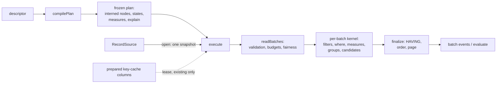
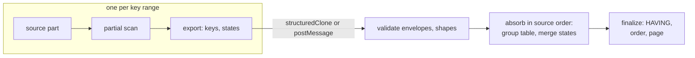

# Compute architecture

A compute plan is prepared once and executed many times. Preparation turns a descriptor into a frozen, source-independent plan. Execution binds that plan to one source snapshot, scans it once and releases everything it acquired.

## Preparation

`compilePlan` validates the whole descriptor before any source opens: property names, aliases, operators, arity, node versions, field keys and paths, cycles, depth (64) and node count (10,000). It interns expressions, so two structurally identical subtrees become one node; object literals keep their identity. Every node records how many places reference it.

Measures become state specifications. `sum(x)` and `avg(x)` with the same operand and predicate share one state, as do repeated `count()` calls. `explain()` reports the result: operators, measures, the number of states and the strategies an execution may pick.

Why a frozen plan instead of compiling per call: the same plan then runs concurrently on several sources without shared mutable state, and every validation error appears at preparation, not halfway through a scan.

## Execution

An execution opens one snapshot and validates the session. It asks the source for already-built key-cache columns of the fields the plan reads. Compute never builds a column itself, so a plan's cost never includes a hidden cache build, and a throwing accessor on a rejected row is never touched. The lease pins those columns until the execution ends.

`readBatches` in `src/stream/driver.ts` applies the stream executor's batch rules, and both share its `validateSession`: it pulls batches, validates their shape and row sizes, yields to the host every `yieldEveryBatches` batches and checks the signal. The compute kernel then runs once per batch, as a plain synchronous function. VERIFIED: moving the row loop out of the async generator into that function cut a 200,000-row scalar sum from 10.6 to 7.0 ms, level with the stream scan of the same rows (2026-11-17).

Each row's evaluators are closures built once per execution. A field reads from a leased column when one exists, else from the row through an own-property check. A node referenced more than once is memoized per row. Arithmetic, comparison and Boolean operators follow COMPUTE_SEMANTICS.md.

## Strategies

| Strategy | When | Memory |
| --- | --- | --- |
| `scan` | Rows without `orderBy` | The current output batch |
| `ordered` | Rows whose field `orderBy` the source ordering already satisfies | The current output batch |
| `top-k` | Rows with `orderBy` and a `limit`: a stable heap of `offset + limit` candidates | O(k) candidates |
| `sort` | Rows with `orderBy` and no `limit` | Every match |
| `scalar` | Aggregates without `groupBy`, and view totals | One state slot |
| `hash` | Grouped aggregates | One entry per group |
| `ordered-groups` | Grouped aggregates over a certified ordering | One live group |
| `first-seen` | Grouping-only first pages | `offset + limit + 1` groups |
| `merge` | `merge()`: partials folded into one group table | One entry per merged group |

Grouping uses a trie of native Maps, one level per key component. Each level splits keys into separate maps by family: primitives, value-mode Dates by timestamp, value-mode binary values by their bytes, and other objects by identity. SameValueZero on primitives gives exactly the grouping equality, so no key is serialized or joined with a delimiter that could merge distinct tuples.

Measure state lives in columns indexed by group id: typed arrays for counts and sums, arrays for `min`, `max` and `sumBigInt` values. An object per group holding all accumulators would cost an allocation per group and scatter the state.

Ordered groups need a certificate, because a wrong one would silently split a group:

- the source ordering is code-unit ordering (`dataview-order-v1:code-unit`);
- its leading sorters are exactly the plain group fields;
- every group field has a leased column whose values are all Booleans, all finite numbers, all BigInts or all strings.

In those domains, comparator ties coincide with grouping equality. Nullish values, locale collation, identity Dates and mixed types fail the certificate and fall back to hashing.

## Partial and final stages

`partial()` and `merge()` split an aggregate plan into a partial stage per part of the snapshot and one final stage. Both run inside the same executor as `evaluate()`. A partial execution scans its part with hash or scalar grouping, then exports the group keys and state columns instead of finalizing them. A merge execution opens no source: `src/compute/partial.ts` folds the validated partials into a fresh group table and fresh state columns, and the usual finalization applies HAVING, ordering and paging.

Why the final stage reuses the executor instead of a separate merge function: finalization, HAVING, ordering, paging, output batching and the memory ledger stay one implementation, so merged and single-pass results come from the same finalization code. Why partials carry states and not finished groups: HAVING, `avg` and ordering are only correct over whole groups, and a group can span parts.

A partial never uses ordered groups, which keep one live group and discard it once closed. Each state kind exports its own column: counts as a `Float64Array`, exact sums as their term lists packed into one `Float64Array` with offsets, `min`, `max` and `sumBigInt` as value arrays. Each kind also merges its own slot: counts and BigInt sums add, `min` and `max` apply the normal update, and exact sums add every term of the other part. The export reserves its copies in the ledger.

Why `numberMode: 'exact'` instead of merging compensated sums: a Neumaier pair from one part, added to another, gives a result that depends on where the parts were split. Shewchuk's expansion keeps nonoverlapping terms whose sum is exactly the sum of the inputs, so adding a part's terms is exact, and one final rounding gives the same double for every order and split. It costs a short array per group and a loop over its terms per addition (COMPUTE_PERFORMANCE.md).

Group keys travel as their representative values. Value-mode Dates and binary values group by value, so a copy groups like the original. A plain object, or any object under identity equality, groups by identity, which a copy loses; partials reject such keys. The signature is a 53-bit fingerprint of the descriptor, walked in property order, and detects a partial of another plan by accident. Merge treats every partial as untrusted input: it checks the envelope and column shapes first, then each count, term and value while it folds them in.

## Memory

A `Ledger` reserves bytes before every allocation and releases the old size after a resize, so `maxWorkingBytes` bounds the peak including resize overlap. Group entries, retained keys, state columns, `min`/`max` representatives, BigInt growth, ordered group outputs and sort candidates all reserve. `maxGroups` fails before a group id is assigned. Output rows are sized by `sizeOfOutput`, split by `batchSize` and `maxBatchBytes`, and `evaluate()` also enforces `maxOutputRows` and `maxOutputBytes`.

## Lifecycle

An execution ends in exactly one of three ways: completion, an error, or an early return by the consumer. All three release the column lease, return the batch iterator and close the session. When cleanup fails too, the original error comes first in an `AggregateError`. The completion event is emitted only after cleanup succeeded, so a consumer that saw `complete` knows the source is closed.

## Security and privacy

Plans are data, not code: descriptors are validated plain objects, and nothing is compiled with `eval` or `new Function`. Unsafe keys (`__proto__`, `prototype`, `constructor`) are rejected in field keys, paths and aliases, and alias objects must be plain, so a descriptor parsed from JSON cannot pollute prototypes. Compute performs no I/O and keeps no data between executions.
